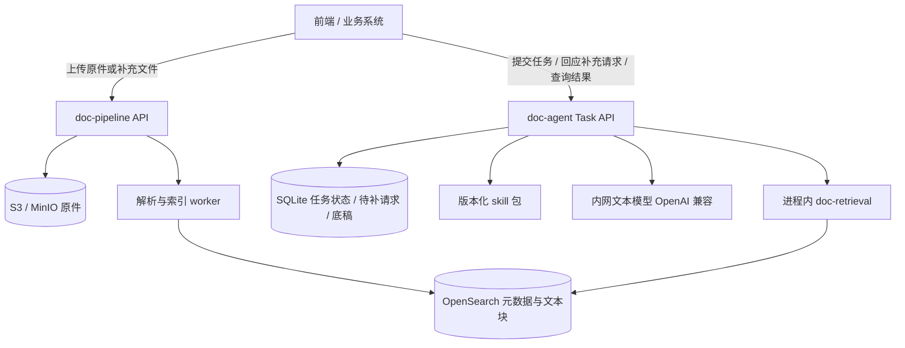

# k-agent（DocAgent）

证券公司合同合规审核平台。任务为中心的文本审核：用户提交材料，Agent 调用指定 skill 完成审核；遇到影响审核路径或阻止实质审核的缺口时，用户可在同一任务内补充文字或文件，也可选择按现有材料出结果。实现依据 [docagent-design-v0.5.md](../docagent-design-v0.5.md)（本地设计稿，不入库）。

## 总体架构



- **doc-pipeline**（Python 3.12+）：原件登记、PDF/DOCX 解析（pdfplumber / python-docx）、按条款边界切块（约 800 token）、OpenSearch 索引发布、版本管理与失败重试。
- **doc-agent**（Node 22+，TypeScript）：任务状态机（queued / waiting_index / running / waiting_for_input / completed / failed / cancelled）、skill 加载（目录或 ZIP、内容摘要版本化、路径约束）、模型与工具循环（Vercel AI SDK + OpenAI 兼容端点）、working-papers 底稿校验、待补请求（3 张上限）、补件接纳协议（幂等 / 409 / 原子事务）、覆盖判定与运行时成文、检查点与重启恢复。
- **前端**：单页静态页（提交任务 / 任务详情轮询 / 待补卡 / Markdown 结果渲染）。

## 目录结构

```
├── docker-compose.yml          # MinIO + OpenSearch（dev 基础设施）
├── .env.example                # 配置样例（复制为 .env）
├── services/
│   ├── docagent-pipeline/      # Python FastAPI 文档处理服务
│   │   ├── app/
│   │   │   ├── main.py         # REST API
│   │   │   ├── worker.py       # uploaded→parsing→structuring→indexing→ready
│   │   │   ├── metastore.py    # OpenSearch 元数据（版本、状态、缺口）
│   │   │   ├── search.py       # 文本块索引写入
│   │   │   ├── s3store.py      # 原件存储
│   │   │   └── parsers/        # pdfplumber / python-docx + 条款切块
│   │   └── tests/
│   └── docagent-agent/         # Node TypeScript 任务服务
│       ├── src/
│       │   ├── runner/         # 执行循环、工具集、上下文预算、模型接入
│       │   ├── skills/         # skill 包加载与注册表
│       │   ├── papers.ts       # working-papers 校验与覆盖统计
│       │   ├── outcome.ts      # review_outcome 判定与成文
│       │   ├── taskService.ts  # 创建 / 补件接纳 / 取消
│       │   ├── scheduler.ts    # 并发上限、waiting_index 轮询、重启恢复
│       │   └── httpApi.ts      # 任务 API + SSE + 静态前端
│       ├── test/               # vitest
│       └── web/                # 前端静态页
└── var/                        # 运行数据（gitignore）：任务库、已安装 skill
```

## 快速开始（dev）

前置：Docker、Python 3.12+、Node 22+。

```bash
# 0. 配置
cp .env.example .env            # 按内网实际端点修改模型与服务地址

# 1. 基础设施（MinIO + OpenSearch）
docker compose up -d

# 2. doc-pipeline
cd services/docagent-pipeline
python -m venv .venv && .venv/Scripts/pip install -r requirements.txt   # Windows；Linux 用 bin/pip
.venv/Scripts/python -m uvicorn app.main:app --port 8000

# 3. 安装 skill 包（目录或 ZIP；也可 PUT 到 var/skills/ 后重启 agent）
mkdir -p ../../var/skills
cp /path/to/securities-contract-compliance.zip ../../var/skills/

# 4. doc-agent
cd ../docagent-agent
npm install && npm run build
npm start                        # 监听 :8001，启动时扫描安装 var/skills

# 5. 前端
open http://localhost:8001/
```

模型端点必须可达（`MODEL_BASE_URL`，OpenAI 兼容，如内网 vLLM/SGLang 的 Qwen3.8-27B）。没有模型时任务会以执行失败终态返回原因；文档入库、检索、任务 API 与待补状态机均可独立验证。

### 冒烟自检

```bash
curl -s localhost:8001/healthz
curl -s -H 'x-tenant-id: t1' -H 'x-user-id: u1' localhost:8001/api/skills
curl -s -F 'file=@合同.docx' -H 'x-tenant-id: t1' -H 'x-user-id: u1' localhost:8000/api/v1/docs
# doc_id 就绪后：任务创建（role=主合同）
curl -s -X POST localhost:8001/api/tasks -H 'content-type: application/json' \
  -H 'x-tenant-id: t1' -H 'x-user-id: u1' \
  -d '{"scenario":"采购合同审核","docs":[{"doc_id":"<doc_id>","role":"主合同"}]}'
```

## 配置要点

| 变量 | 说明 |
|---|---|
| `MODEL_BASE_URL` / `MODEL_NAME` | 内网 OpenAI 兼容端点与模型名 |
| `AGENT_SKILLS_DIR` / `AGENT_DATA_DIR` | skill 包根 / 任务库持久卷（相对路径锚定仓库根） |
| `MAX_RUNNING_TASKS` / `MAX_STEPS` / `MAX_TASK_TOKENS` | 并发与预算（设计 §4.4：初始运行上限 4） |
| `REQUEST_INPUT_LIMIT` | 每任务待补卡上限（默认 3） |
| `WAITING_INDEX_TIMEOUT_SECONDS` | 等待索引超时（超时按单份材料不可用处理） |

## API 摘要（agent :8001）

| 调用 | 行为 |
|---|---|
| `POST /api/tasks` | `scenario, skill, docs[], idempotency_key?` → 任务与实际绑定版本 |
| `GET /api/tasks/{id}` | 状态、输入修订、进度、材料问题；待补时返回 `pending_input` |
| `POST /api/tasks/{id}/input` | 回应 `request_id`：`supplement`（文字 / add_docs / replace_docs）或 `finish_with_available` |
| `GET /api/tasks/{id}/result` | `completed` 后返回 `conclusion_md` 等结果；执行中 202 |
| `GET /api/tasks/{id}/events` | SSE（可选，前端也可仅轮询） |
| `POST /api/tasks/{id}/cancel` | 取消非终态任务 |
| `GET /api/skills`、`POST /api/skills/install` | 技能清单 / 从目录或 ZIP 安装 |

pipeline（:8000）：`POST /api/v1/docs`、`POST /api/v1/docs/{id}/versions`、`GET /api/v1/docs/{id}?version=`、`GET /outline`、`GET /versions/{v}/blocks[/{block_id}]`、`POST /api/v1/tasks/{job_id}/retry`。

身份（M1 dev）：请求头 `x-tenant-id` / `x-user-id`（`x-admin: 1` 管理员视角；`x-internal-key` 供 agent 内部调用）。

## 测试

```bash
cd services/docagent-agent && npm test       # vitest：底稿校验、覆盖判定与成文、
                                             # skill 加载、补件接纳协议、上下文预算、纯追问识别
cd services/docagent-pipeline && .venv/Scripts/python -m pytest tests/ -q
```

## M1 边界与实现说明

- 输入为数字版 PDF / DOCX；扫描件标记 `needs_ocr` 暂不可读。XLSX/PPTX、OCR、Word 生成、子 Agent、语义检索（Milvus）均不在本期。
- 结论正文始终由**运行时按 working-papers 组装**（模型成文与兜底成文同一路径）：空底稿或损坏写入不能产生“全部核查完毕”的统计；全部核查且无发现时必须附核查范围摘要。
- 材料引用粒度为文件级（`doc_id + version`）；逐条定位与可点击引用留作后续增强。
- 底稿在 `conclusion_hint` 基础上支持可选 `finding.location / basis`，对齐合规包输出模板四要素；成文章节名沿用 skill 模板（【结论】【审核意见】等）。
- 任务存储为 SQLite（node:sqlite，WAL）。设计 §7 要求“任务存储能原子完成回答接纳与恢复调度登记”——已用单事务实现（`taskService.acceptInput`）；换企业级存储时替换 `src/db.ts` 实现即可。
- 调度为进程内定时器；waiting_index 轮询 pipeline 状态，超时按单份材料不可用回到审核逻辑。
- SSE 为轮询数据库的简化实现（每连接 2s 查询），适合 M1 规模。

## 路线（设计 §7）

- **M2**：Milvus + embedding、skill/MCP/场景管理、跨用户流转（按业务决定）。
- **M3**：OCR、XLSX/PPTX、子 Agent、跨文档要素抽取。
- **M4**：Word 生成（docsvc）、模板与预览下载。
